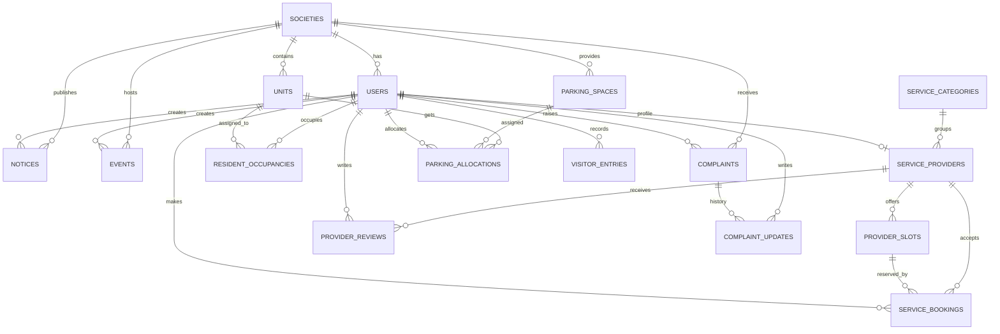

# Database Design for SocioNeed

## Overview
SocioNeed uses a SQLite database because the project needs a lightweight, file-based relational store that is easy to run locally for the frontend and backend deliverables. The schema below is normalized around the main workflows in the system: notices and events, service directory and bookings, complaint management, and parking tracking.

## Design Goals
- Keep the schema simple enough for a student project while still reflecting real society operations.
- Separate master data, transactional data, and status/history records.
- Support the four user roles in the system: admin, owner/resident, service provider, and security personnel.
- Use foreign keys and indexes so the database is consistent and easy to query.

## Main Entities

### 1. users
Stores all system users, including admins, owners, tenants, service providers, and security staff.
- Key fields: `id`, `society_id`, `role`, `full_name`, `email`, `phone`, `password_hash`, `status`
- Purpose: authentication, authorization, and audit ownership of records.

### 2. societies
Stores the society or residential community details.
- Key fields: `id`, `name`, `address`, `city`, `pincode`, `contact_email`, `contact_phone`
- Purpose: supports one or more society deployments.

### 3. units
Stores flats, apartments, or houses inside the society.
- Key fields: `id`, `society_id`, `block_name`, `unit_number`, `floor`, `unit_type`, `status`
- Purpose: maps residents to their home unit.

### 4. resident_occupancies
Links a user to a unit as an owner or tenant.
- Key fields: `id`, `unit_id`, `user_id`, `occupancy_type`, `start_date`, `end_date`
- Purpose: keeps occupancy history accurate when tenants change.

### 5. service_categories
Stores categories such as housekeeping, plumbing, electrician, laundry, and car wash.
- Key fields: `id`, `name`, `description`
- Purpose: makes service search and filtering consistent.

### 6. service_providers
Stores verified provider profiles.
- Key fields: `id`, `user_id`, `category_id`, `business_name`, `service_description`, `verification_status`, `rating_avg`
- Purpose: lets residents browse trusted providers.

### 7. provider_slots
Stores the availability of a service provider.
- Key fields: `id`, `provider_id`, `slot_start`, `slot_end`, `is_available`
- Purpose: enables booking and prevents double booking.

### 8. service_bookings
Stores booking requests made by residents.
- Key fields: `id`, `resident_user_id`, `provider_id`, `slot_id`, `booking_status`, `request_notes`
- Purpose: tracks service appointment lifecycle.

### 9. notices
Stores announcements, maintenance notices, and emergency updates.
- Key fields: `id`, `society_id`, `created_by_user_id`, `title`, `body`, `notice_type`, `priority`, `publish_at`, `expires_at`
- Purpose: central notice board for residents.

### 10. events
Stores community events such as meetings, celebrations, and drives.
- Key fields: `id`, `society_id`, `created_by_user_id`, `title`, `description`, `event_date`, `start_time`, `end_time`, `venue`, `status`
- Purpose: supports event scheduling and display.

### 11. complaints
Stores resident complaints and their current status.
- Key fields: `id`, `society_id`, `raised_by_user_id`, `assigned_to_user_id`, `subject`, `description`, `category`, `priority`, `status`
- Purpose: provides visible issue tracking.

### 12. complaint_updates
Stores progress updates and status changes for complaints.
- Key fields: `id`, `complaint_id`, `updated_by_user_id`, `status`, `comment`, `updated_at`
- Purpose: preserves complaint history.

### 13. parking_spaces
Stores all parking slots in the society.
- Key fields: `id`, `society_id`, `space_number`, `space_type`, `current_status`, `assigned_unit_id`
- Purpose: shows occupied, available, and reserved spaces.

### 14. parking_allocations
Stores permanent or temporary parking assignments for resident vehicles.
- Key fields: `id`, `parking_space_id`, `unit_id`, `vehicle_number`, `allocated_by_user_id`, `allocation_status`, `allocated_at`, `released_at`
- Purpose: keeps parking allocation transparent.

### 15. visitor_entries
Stores visitor vehicle records handled by security.
- Key fields: `id`, `society_id`, `recorded_by_user_id`, `resident_user_id`, `visitor_name`, `vehicle_number`, `contact_number`, `entry_time`, `exit_time`, `parking_space_id`
- Purpose: tracks visitor movement and parking.

### 16. provider_reviews
Stores ratings and feedback submitted after bookings.
- Key fields: `id`, `provider_id`, `resident_user_id`, `booking_id`, `rating`, `feedback`, `created_at`
- Purpose: supports provider quality improvement.

## Relationship Summary
- One society has many users, units, notices, events, complaints, and parking spaces.
- One unit can have one or more occupancy records over time.
- One service category can have many providers.
- One provider can have many availability slots and bookings.
- One complaint can have many updates.
- One parking space can be linked to one allocation at a time.
- One booking can generate one review.

## ER Diagram

## SQLite Notes
- Use `PRAGMA foreign_keys = ON;` so linked rows stay consistent.
- Use `INTEGER PRIMARY KEY AUTOINCREMENT` for identifier columns.
- Use `TEXT` for dates and timestamps in ISO-8601 format.
- Use `CHECK` constraints for fixed status values like `active`, `open`, `resolved`, and `available`.

## Suggested File Name
- `socioneed.db` for the SQLite database file.
